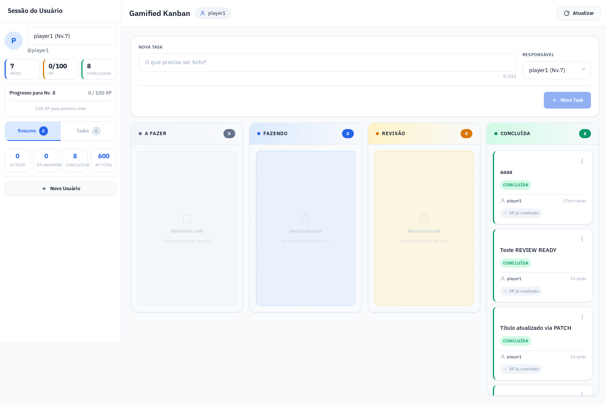
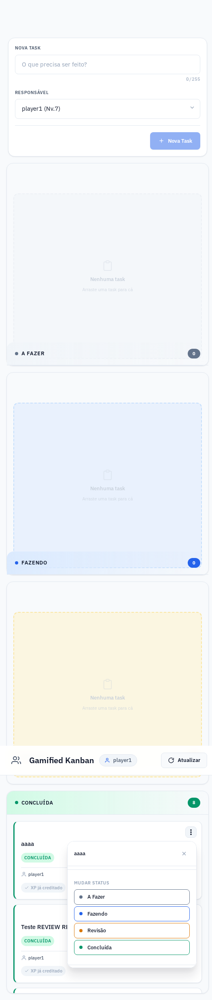

# Gamified Kanban

Quadro Kanban gamificado com 4 colunas: **TODO → DOING → REVIEW → READY**.
Quando uma task chega em **READY**, o usuário ganha **50 XP**. A cada **100 XP** sobe um nível, e o que sobrar passa pro próximo.

Cada task paga XP **uma vez só**. Não dá pra farmar XP movendo a mesma task de READY pra REVIEW e de volta.

---

## Índice

- [O que o app faz](#o-que-o-app-faz)
- [Por que este projeto existe](#por-que-este-projeto-existe)
- [Stack](#stack)
- [Como rodar](#como-rodar)
- [Rotas da API](#rotas-da-api)
- [Regras de negócio](#regras-de-negócio)
- [Limitações conhecidas](#limitações-conhecidas)
- [Testes](#testes)
- [Estrutura de pastas](#estrutura-de-pastas)
- [Licença](#licença)

---

## O que o app faz

O quadro mostra só as tasks do usuário selecionado na sidebar. Cada coluna tem uma cor e o usuário ativo aparece no cabeçalho.

Cada task tem um botão "⋮" com um menu pra editar o título, mudar o status ou excluir. O menu é renderizado num portal fora da coluna, então não fica escondido atrás dos cards.

| Board principal | Menu de ações |
|---|---|
|  |  |

---

## Por que este projeto existe

Fiz esse app com ajuda de IA (OpenCode) pra aprender a usar esse tipo de ferramenta no dia a dia de desenvolvimento: descrever o que eu quero, revisar o que ela devolve e testar de verdade no navegador. O objetivo não era só ter o app pronto, era treinar essa revisão.

Alguns casos que aconteceram no caminho:

- **XP farmável:** na primeira versão, a task dava XP toda vez que entrava em READY. Testando no navegador eu vi que dava pra mover a mesma task de READY pra REVIEW e voltar pra READY e ganhar XP de novo. A correção foi a coluna `xp_awarded` (migration 003): a task só paga uma vez, e o XP não é tirado se ela sair de READY.
- **Menu escondido atrás dos cards:** o menu do "⋮" abria por baixo dos cards da coluna. Notei isso usando o app mesmo. A solução foi renderizar o menu num portal, fora da coluna.
- **Datas com 3 horas de diferença:** a coluna `created_at` era `TIMESTAMP` sem fuso, e a API devolvia datas no futuro, então na tela aparecia "-1d atrás". Mudei pra `TIMESTAMPTZ` (migration 002) e coloquei teste nos helpers de data do front.

---

## Stack

| Camada | Tecnologia |
|--------|------------|
| Back-end | Node 22 + Express + `pg` |
| Front-end | React 19 + Vite + `@dnd-kit` |
| Banco | PostgreSQL 15 (Docker) |
| Testes | `node:test` (back) + Vitest (front) |
| Estilização | CSS puro (IBM Plex, variáveis de CSS) |
| Deploy | Docker Compose + Nginx |
| CI | GitHub Actions |

---

## Como rodar

### Pré-requisitos

- Git
- **Com Docker:** Docker e Docker Compose
- **Sem Docker:** Node 22 e um PostgreSQL 15 rodando na sua máquina

### Com Docker Compose (recomendado)

```bash
git clone https://github.com/hgiulliano/gamified-kanban-node.git
cd gamified-kanban-node

cp back-end/.env.example back-end/.env
cp front-end/.env.example front-end/.env

docker compose up --build
```

Acessos:
- **App**: http://localhost:8080
- **API**: http://localhost:3000
- **Postgres (host)**: localhost:5433

Os usuários `demo_ana` e `demo_bruno` são criados automaticamente.

### Sem Docker

Primeiro crie o banco no seu Postgres e rode o `back-end/init.sql` nele (cria as tabelas).
Depois ajuste no `back-end/.env` as variáveis de conexão: `DB_HOST`, `DB_PORT`, `DB_USER`, `DB_PASSWORD` e `DB_NAME`.

```bash
# Back-end
cd back-end
cp .env.example .env   # ajuste DB_HOST, DB_PORT, DB_USER, DB_PASSWORD, DB_NAME
npm ci
npm run migrate        # aplica as migrations pendentes
npm run seed           # dados de exemplo (opcional)
npm run dev            # :3000

# Front-end (em outro terminal)
cd front-end
cp .env.example .env
npm ci
npm run dev            # :5173
```

---

## Rotas da API

| Método | Caminho | Descrição |
|--------|---------|-----------|
| `GET` | `/health` | Healthcheck |
| `GET` | `/users` | Lista os usuários (nível, XP) |
| `GET` | `/users/:id` | Usuário por ID |
| `POST` | `/users` | Cria usuário (3 a 50 caracteres, letras, números, `_` ou `-`) |
| `GET` | `/tasks` | Lista todas as tasks, com os dados do usuário |
| `POST` | `/tasks` | Cria task |
| `PATCH` | `/tasks/:id` | Edita o título |
| `PATCH` | `/tasks/:id/status` | Muda o status (`TODO`, `DOING`, `REVIEW` ou `READY`) e concede XP ao ir pra `READY`, uma vez só |
| `DELETE` | `/tasks/:id` | Exclui a task |

Obs.: `/tasks` devolve as tasks de todos os usuários. O filtro por usuário é feito no front-end (`KanbanContext.jsx`).

---

## Regras de negócio

- **Colunas**: `TODO`, `DOING`, `REVIEW`, `READY`.
- **XP**: `READY` dá +50 XP. Cada 100 XP é +1 nível, e o resto continua pro próximo.
- **XP só uma vez**: a coluna `tasks.xp_awarded` impede de pagar duas vezes pela mesma task.
- **Tirar de READY não tira o XP**: se a task sair de READY, o XP já ganho fica.
- **Race condition**: a mudança de status roda numa transação. O `UPDATE ... WHERE xp_awarded = FALSE` só dá certo pra uma requisição, e o usuário é lido com `FOR UPDATE` antes de somar o XP. Assim duas requisições ao mesmo tempo não pagam duas vezes.
- **Datas**: `created_at` é `TIMESTAMPTZ` (UTC), pra não aparecer "criada há -1 dia" por causa de fuso.
- **Board**: mostra só as tasks do usuário selecionado na sidebar.
- **UI**: sem emojis, fonte IBM Plex, cores padronizadas, responsiva.

---

## Limitações conhecidas

- Não tem autenticação. O "usuário" é só quem está selecionado na sidebar.
- Os testes do front cobrem só os helpers de data. A interface em si não tem teste automatizado.

---

## Testes

```bash
# Back-end (node:test: regras de XP + API de ponta a ponta)
cd back-end
npm test

# Front-end (Vitest: helpers de data)
cd front-end
npm test

# Build e lint (rodar dentro de front-end)
cd front-end
npm run build
npm run lint
```

---

## Estrutura de pastas

```
.
├── back-end/
│   ├── lib/xp.js            # regras de XP e level up (testável isolado)
│   ├── server.js            # Express + rotas + Pool
│   ├── scripts/migrate.js   # aplica as migrations SQL (npm run migrate)
│   ├── scripts/seed.js      # dados de demonstração (npm run seed)
│   ├── migrations/          # SQL versionado
│   ├── test/                # testes de integração
│   ├── Dockerfile
│   ├── .env.example
│   └── package.json
├── front-end/
│   ├── src/
│   │   ├── context/KanbanContext.jsx   # estado global + usuário selecionado
│   │   ├── components/                 # Board, Column, TaskCard, TaskMenu...
│   │   ├── services/api.js             # camada de fetch
│   │   ├── utils/date.js               # datas relativas (testável)
│   │   ├── App.jsx
│   │   ├── App.css
│   │   └── index.css
│   ├── Dockerfile
│   ├── nginx.conf
│   ├── .env.example
│   └── vite.config.js
├── docs/screenshots/          # imagens do README
├── docker-compose.yml         # sobe db + api + web
├── .github/workflows/ci.yml   # lint + testes + build a cada push
├── LICENSE (MIT)
└── README.md
```

---

## Licença

MIT. Pode usar, estudar e adaptar.

---

Feito com OpenCode, Node, React e PostgreSQL.
